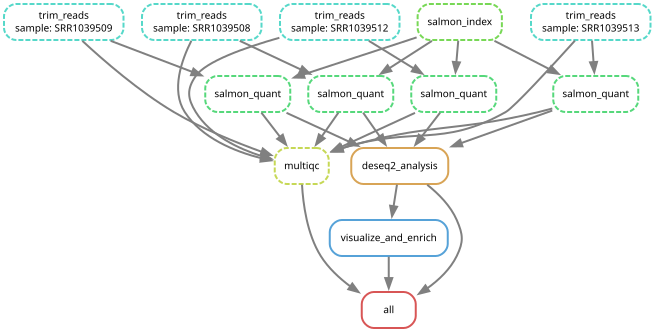
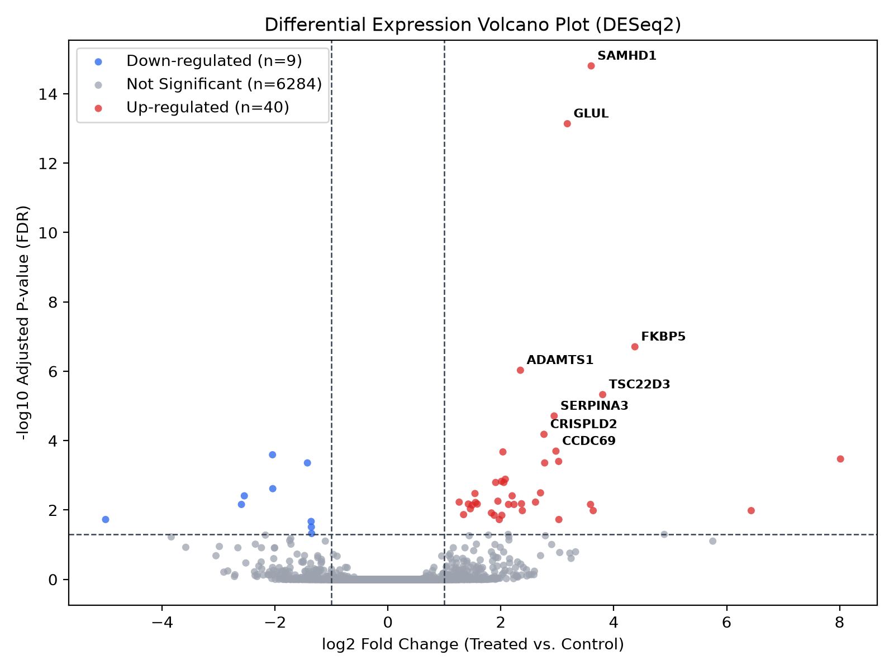
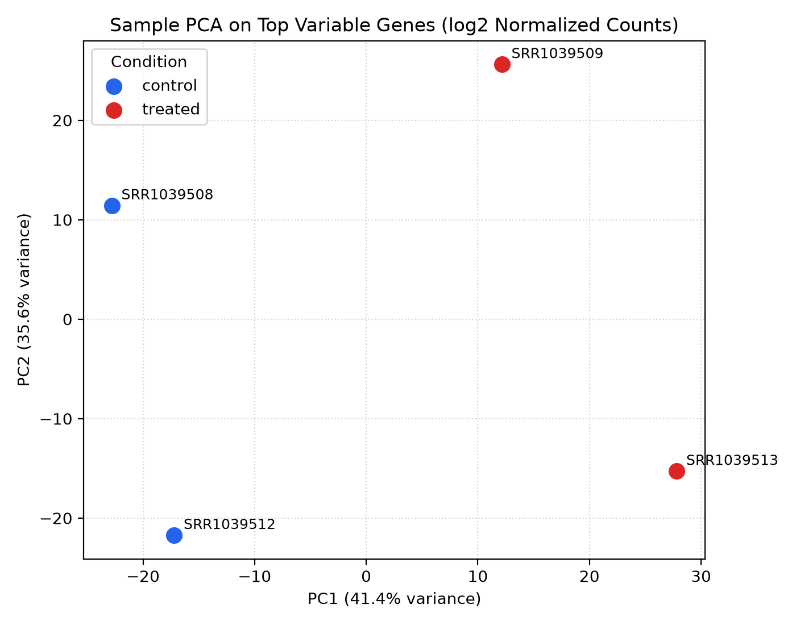

# Automated Bulk RNA-seq Snakemake Pipeline (fastp -> Salmon -> tximport -> DESeq2 -> ORA)

End-to-end reproducible Snakemake workflow demonstrated on human airway smooth muscle dexamethasone RNA-seq reads (GSE52778).

## Workflow DAG

## Top 10 Differentially Expressed Genes (DESeq2)
| gene_id | baseMean | log2FoldChange | lfcSE | stat | pvalue | padj |
| --- | --- | --- | --- | --- | --- | --- |
| SAMHD1 | 275.7533 | 3.6002 | 0.4005 | 8.99 | 0.0 | 0.0 |
| GLUL | 453.0982 | 3.1772 | 0.3748 | 8.4776 | 0.0 | 0.0 |
| FKBP5 | 53.8739 | 4.3741 | 0.6753 | 6.4777 | 0.0 | 0.0 |
| ADAMTS1 | 593.7216 | 2.3464 | 0.3789 | 6.1933 | 0.0 | 0.0 |
| TSC22D3 | 51.9754 | 3.8034 | 0.645 | 5.8965 | 0.0 | 0.0 |
| SERPINA3 | 77.1755 | 2.9439 | 0.5232 | 5.6263 | 0.0 | 0.0 |
| CRISPLD2 | 71.1658 | 2.7635 | 0.5132 | 5.3845 | 0.0 | 0.0001 |
| CCDC69 | 52.514 | 2.9754 | 0.5772 | 5.1551 | 0.0 | 0.0002 |
| NNMT | 156.394 | 2.036 | 0.3974 | 5.1234 | 0.0 | 0.0002 |
| CXCL12 | 498.2446 | -2.045 | 0.4036 | -5.0675 | 0.0 | 0.0003 |

## Pathway Over-Representation Analysis (ORA)
| pathway | description | universe_size_M | pathway_in_universe_n | query_size_N | overlap_k | p_value |
| --- | --- | --- | --- | --- | --- | --- |
| GLUCOCORTICOID_RECEPTOR_PATHWAY | Canonical dexamethasone-responsive genes | 6333 | 17 | 49 | 13 | 1.4633939388833215e-25 |
| EXTRACELLULAR_MATRIX_ORGANIZATION | Airway smooth muscle structural remodeling | 6333 | 11 | 49 | 2 | 0.0030852918396257 |
| INFLAMMATORY_CYTOKINE_SIGNALING | Pro-inflammatory mediators suppressed by steroids | 6333 | 1 | 49 | 0 | 1.0 |
| CELL_CYCLE_G2M_CHECKPOINT | Cell proliferation markers | 6333 | 1 | 49 | 0 | 1.0 |
| OXIDATIVE_PHOSPHORYLATION | Mitochondrial respiratory chain | 6333 | 10 | 49 | 0 | 1.0 |

## Diagnostic Plots

 

